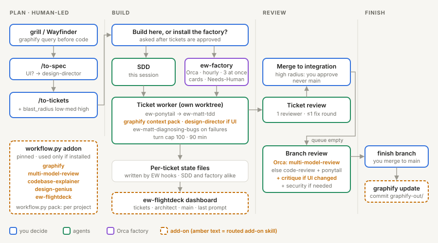

# Factory mode for the engineering workflow (design draft)

Status: proposal, nothing built. Target: engineering-workflow v0.3.0 (installed v0.2.2).
Runs on: Orca 1.4.238 (`orca automations`, `orca orchestration`, `orca worktree`).

## Goal

Keep the front half of the workflow as it is (grill or Wayfinder, then `/to-spec`,
then `/to-tickets`). After the tickets are approved, the workflow offers to install a
"software factory" for the project: an Orca-hosted loop that keeps building ready
tickets in parallel, without a person in the chat, until it is paused.

The person controls it with four verbs: install, pause, resume, run one cycle then pause.

Borrowed from Ona's Software Factory: the stage pipeline, "humans on the loop", a
Needs-Human queue, a quality file that learns. Borrowed from CodeAF: code lands on an
integration branch, never main; one queue across projects; spend caps. Borrowed from
addyosmani/factory: review-pile back-pressure, branch claims, a gate script that
decides "passed". Borrowed from Super Simple Software Factory: code owns the loop,
agents own only the work inside one ticket.

## What stays the same

| Step | Today | In factory mode |
|---|---|---|
| Plan | grill / Wayfinder → to-spec → to-tickets | unchanged, always human-led |
| Build | SDD in one chat session, subagents | `workflow.py factory tick` (plain Python) runs the loop; each ticket is one Orca agent running one-ticket SDD |
| Per-ticket review | 1 implementer, 1 Sonnet reviewer, ≤1 fix round | unchanged |
| Second failed review | escalate to human in chat | Orca decision gate + unread dot ("Needs you") |
| Merge | into integration branch | unchanged; never main |
| Final review | code-review + ponytail-review (+ security) | runs when the queue empties, then the factory pauses itself; on Orca this is multi-model-review (see skill routing) |
| Finish branch | finishing-a-development-branch | still human: the factory never merges to main or deploys |

## Where the install prompt appears

1. Right after `/to-tickets` is approved: "Build here (SDD in this session), or install
   the factory?" Options: Build here / Install and run / Install paused / Run one cycle.
2. At session start, when a factory exists, the session report adds one line:
   `factory: paused · 4 ready · 1 needs you` and offers Resume / One cycle / Leave it.

## Who owns the loop

Code owns sequencing, caps and acceptance. Agents own only the work inside one ticket.
No LLM decides what runs next, whether a ticket passed, or when to pause, so those
rules behave exactly as written and cost no tokens.

```
heartbeat (Orca, hourly) ─┐
worker finishes ticket ───┼─> workflow.py factory tick   (Python, seconds, idempotent)
you run cycle/resume ─────┘        │
                                   ├─ enforce caps (minutes, turns) and stop overruns
                                   ├─ approved tickets: re-run gates → merge, or gate if high radius
                                   ├─ review pile ≥ stop_if_waiting? start nothing
                                   ├─ claim + start ready tickets up to concurrency
                                   └─ mode bookkeeping (once → paused, draining → paused)
```

`tick` is short and safe to run any number of times: it takes a lock file, reconciles
the ledger with Orca's worker list and git, does what is due, and exits. Progress is
event-driven (each worker ends by calling `factory report`, which runs `tick`); the
hourly heartbeat is only the backstop.

## Pieces (v1)

- `workflow.py factory install|status|pause|resume|cycle|tick|report|uninstall`.
- State file `.engineering-workflow/factory.json` (gitignored, local to the host):
  `mode` (`running|paused|once|draining`), `concurrency`, `daily_ticket_cap`,
  `stop_if_waiting`, `build_slots`, `max_turns`, `max_minutes`, `automation_id`,
  `integration_branch`, `last_tick`.
- One Orca automation, the heartbeat:
  `orca automations create --name "factory:<project>" --trigger hourly
   --provider claude --repo id:<repoId> --workspace <integration worktree>
   --precheck "python3 .engineering-workflow/workflow.py factory precheck"
   --extra-agent-args="--model haiku"
   --prompt "Run: python3 .engineering-workflow/workflow.py factory tick. Report its output. Do nothing else."`
  The precheck exits 0 whenever a ticket is working, in any mode (tick still reconciles
  and caps it, and starts nothing while paused); otherwise only when mode is not `paused`
  and there is something to do (ready tickets or approved tickets to merge). Otherwise Orca records
  a skipped run and spends nothing. When it does run, the agent is a cheap model that
  only runs one command.
- New skill `ew-factory`: the one-ticket worker brief. It is SDD for a single ticket:
  load ew-ponytail and ew-matt-tdd, implement on the claimed branch, run `gates.sh`,
  have a fresh Sonnet reviewer read the diff cold and prove the new test fails without
  the change, fix once if needed, then `workflow.py factory report <ticket>
  approved|blocked --slowed-by "<one line>"`.
- Orca cards as the dashboard: `tick` sets each ticket worktree's `--workspace-status`
  (in-progress / in-review / completed) and a one-line `--comment`. Needs-Human =
  `orca orchestration gate-create` + `worktree set --unread`.

## Branch claims

`tick` claims a ticket by creating its branch `factory/<ticket-id>` from the integration
tip. Branch creation fails if the branch exists, so two ticks (or two hosts) can never
start the same ticket. With a remote, the claim is the push of that branch: the first
push wins, later ones stop. No lock service.

## Gate script

Each project commits `.engineering-workflow/gates.sh`. It runs the project's real
checks (types, lint, tests, build) and ends with one line:
`GATES: PASS` or `GATES: FAIL <checks>`. A required check that is missing counts as
a FAIL (fail closed). `factory install` writes a starter from the project's own
commands and asks you to approve it.

The worker runs it while working. `tick` runs it again on the ticket branch before
merging and trusts only its own run, never the agent's claim. Both always run it
through the build queue: `workflow.py factory gate`, never `gates.sh` directly.

## Build queue

Three workers building and testing at once on one machine slow each other down,
and the slowdown looks like agents being slow. (Theo's agents waited up to 12 hours
for build machines before he queued and moved builds.)

- `workflow.py factory gate` takes one of `build_slots` slots before running
  `gates.sh`, and gives it back when done. Default 1 slot; raise it if the machine
  has the cores and memory. Slots are lock files under
  `.engineering-workflow/factory/slots/` (`fcntl.flock`, standard library), so a
  crashed worker frees its slot automatically.
- Each ticket's ledger entry records its queue wait and its gate run time.
  `max_minutes` counts working time only, so waiting in the queue never caps a ticket.
- The worker brief tells agents to run heavy builds and the full test suite only
  through `factory gate`; quick focused tests while iterating stay outside the queue.

## What slowed it down

Each worker ends with `factory report ... --slowed-by "<one line>"`: the biggest
thing that cost it time (waiting for builds, a flaky test, missing context, a tool
it lacked). The cycle digest lists those lines next to total queue wait, so you can
see the factory's bottleneck rather than guess at it. Recurring answers go to the
Idea Shelf as factory changes.

## Review-pile back-pressure

`stop_if_waiting` (default 5) caps how much can wait on you: Needs-Human gates,
`high`-radius merge approvals and capped tickets together. At the cap, `tick` starts
no new tickets and the status line says `held: 5 waiting on you`. Mode does not
change; the factory carries on by itself once you clear the pile below the cap.

## How it ties to skill routing



Skill routing (`docs/skill-routing.md`) ships right after this and plugs into the same
loop. The factory needs none of it to work; each piece is used only when installed.

- Workers start their context pack from graphify, and UI tickets go through
  design-genius `design-director`.
- The factory always runs on Orca, so its final review is multi-model-review
  (replacing code-review + ponytail-review), plus `critique` when UI changed.
- The factory's hooks write the same per-ticket state files as SDD, so
  `ew-flightdeck` shows factory tickets next to in-chat ones. Orca cards stay the
  Needs-Human surface.
- `blast_radius: high` already covers the design system; those tickets also get
  `critique` before you approve the merge.

## Turn cap (per ticket)

A stuck agent can loop on one failure for hours and burn the subscription. Each
ticket gets a hard limit; hitting it stops the worker and sends the ticket to
Needs-Human with the last failing output.

- `max_turns` (default 100): agent turns per ticket, implementer and fix round
  together. Counted by the workflow's existing PostToolUse hook, which increments a
  per-ticket counter in the ledger when `EW_FACTORY_TICKET` is set in the worker's
  environment. At the cap the hook tells the agent to stop and report BLOCKED.
- `max_minutes` (default 90): working-time backstop (build-queue wait excluded),
  enforced by `tick` with
  `orca orchestration worker-stop`, for agents that never reach a hook.
- A capped ticket is marked `capped` (not `failed`); its worktree stays. The digest
  asks one question for it: what factory change (skill, CLAUDE.md rule, ticket shape)
  would have prevented this? That answer goes to the Idea Shelf, not into a retry.

Orca has no built-in turn limit (`worker-start` only has `--timeout-ms` for waiting),
so the hook does the counting.

## Blast radius (ticket field)

`/to-tickets` adds `blast_radius: low | medium | high` to each ticket, and you approve
it along with the tickets.

| Radius | Touches |
|---|---|
| low | one component or module inside one service, no shared code |
| medium | shared code inside one service, or a public interface other code calls |
| high | database schema or data, auth, payments, secrets, the design system, or more than one service |

v1 uses it two ways:
- `high` tickets stop at Needs-Human after review passes; you approve the merge into
  the integration branch. `low` and `medium` merge after review, as today.
- The Orca card comment and the digest show it, so you can see what is risky.

v3 risk-tiered auto-merge to main reads the same field; nothing new is needed then.

## One cycle

One cycle = one wave: take every ticket that is ready now (up to `concurrency`),
carry each to merged or Needs-Human, update the ledger, write a digest, stop.
Tickets that a wave unblocks wait for the next cycle.

`factory cycle` sets mode `once` and runs `tick`. `tick` starts the wave, and sets mode
back to `paused` once every ticket in it is merged or waiting on you. "Run until the queue is empty" is
`resume`; the factory pauses itself when nothing is ready and runs the final review.

## Climb and the next feature

A feature can carry one approved goal that the factory climbs once its tickets are built:

```markdown
# Climb: <goal>

**Status:** ready-for-agent
**Blast radius:** low | medium | high
**Metric:** `<command that prints one number>` (direction)
**Target:** <= 50 ms
**Guardrails:** gates.sh, plus any no-regression checks
**Budget:** 15 rounds
```

- Once every ticket is merged and nothing is startable, `tick` claims
  `factory/<feature>-climb` and launches one worker with the ew-factory climb brief,
  which runs ew-hill-climb unattended. The climb is ledger entry `climb`: same gate,
  caps, control-file hold, blast-radius hold, `approve` and `requeue` as a ticket. A
  climb file without `Status: ready-for-agent` is ignored.
- The final review waits until the climb merges, so it reviews the climbed code.
- `factory queue <feature>` (person only) lines up a feature whose tickets are
  approved. When the final review is dispatched, `tick` archives the ledger as
  `ledger-<feature>-<time>.json`, switches to the queued feature on the same
  integration branch and starts its ready tickets in that same tick. Without a queued
  feature, it pauses as before.
- The review brief names the integration tip it covers, because the next feature's
  merges land on top while it runs. Queued features write `final-review-<feature>.md`.
- A queued feature pings the person on every ticket it merges (`BUILT: <feature> NN
  merged`), plus one line when the factory moves on. On Orca the ping sets the
  integration checkout's card with an unread dot; on AO it goes through the relay.

## Pause (two kinds)

- `pause` = drain, at a ticket boundary: no new tickets start; every in-flight ticket
  runs to merged or Needs-Human, then the factory sits at `paused`.
  Mode goes `draining` → `paused`.
- `pause --now` = stop, mid-ticket: `orca orchestration worker-stop` on live workers.
  Their worktrees and commits stay; the ledger marks each ticket `interrupted` with
  its last finished step, and the next cycle resumes it from there.
- Disabling the automation in Orca's UI is a hard pause too; precheck never runs.
- Both are offered wherever the factory is controlled: the CLI, the session-start
  line, and the Needs-Human prompt. No work is discarded by either.

## Guard rails

- Never merges to main, never pushes to main, never deploys, never publishes issues.
- Keeps native permissions: the automation runs in the permission mode the person
  set for that Orca host. Install refuses if unattended runs would need bypass mode.
- Token budget from the workflow is unchanged. Adds `daily_ticket_cap` (default 10).
- Concurrency default 3, capped by `orca orchestration worker-list` accounting.
- No long-lived agent: `tick` is code, and each ticket worker is a fresh session. All
  state is on disk (ledger + factory.json), so compaction never matters.

## Later (Idea Shelf, not v1)

- v2: post-merge verifier on the integration tip; stale-ticket requeue; CI shepherd
  for the integration → main PR.
- v3: operate stations (incident-response on errors, perf watch), feedback → draft
  tickets that wait for human approval, risk-tiered auto-merge to main.
- Cross-project queue: one Orca view of Needs-Human across every factory.
- From theSeniorDev's software-factory video (2026-10-12): deterministic quality
  gates fed back to the implementer (lint, types, duplication, complexity, dead
  code); before/after screenshots in Orca's browser; smoke-test subset plus a QA
  agent that acts as a user; intake agents (triage from Sentry/Slack, refinement
  with repro evidence, prioritizer); anonymized production-like seed data;
  bug-cluster review that points at architecture; strip issue-reference comments.
- From Theo's "How To Give Claude Unlimited Usage" (2026-10-28): offload builds to
  disposable remote VMs or Orca SSH hosts when the queue wait grows (he used a
  service the captions call "boat.dev"); snapshot a warm, built checkout so workers
  skip the full setup; goal tickets that climb a measurable target ("2x faster, all
  checks still pass"); an AI judge panel comparing screenshots when a goal has no
  code check.

## Decisions (2026-10-28)

- Build queue: workers and `tick` run `gates.sh` only through `workflow.py factory
  gate`, which holds one of `build_slots` (default 1) file-lock slots. Queue wait is
  logged per ticket and excluded from `max_minutes`.
- Each worker reports one "slowed by" line; the cycle digest shows them next to total
  queue wait.
- Code owns the loop: `workflow.py factory tick` (Python) does sequencing, caps,
  merges and mode changes; the LLM controller is dropped. `ew-factory` becomes the
  one-ticket worker brief. The heartbeat agent only runs `tick` on a cheap model.
- Branch claims: `tick` creates `factory/<ticket-id>`; existing branch = already
  claimed. With a remote, first push wins.
- Gate script: per-project `.engineering-workflow/gates.sh` ending in
  `GATES: PASS|FAIL`; missing required check = FAIL; `tick` re-runs it before merging.
- Review-pile back-pressure: `stop_if_waiting` (default 5); at the cap `tick` starts no
  new tickets until you clear the pile.
- Per-ticket turn cap: 100 turns (hook-counted) plus a 90-minute wall-clock backstop;
  capped tickets go to Needs-Human with a "what factory change prevents this?" note.
- Tickets carry `blast_radius` (low / medium / high). In v1, `high` tickets need your
  approval before merging into the integration branch.

## Decisions (2026-10-27)

- Pause has two kinds: drain (finish in-flight tickets, then pause) and stop
  (interrupt mid-ticket, resume later from the ledger).
- Heartbeat: hourly Orca automation with precheck.
- Concurrency: 3 by default.
- Home: engineering-workflow repo, new `ew-factory` skill + `workflow.py factory`,
  released as v0.3.0.
- One cycle = one wave (kept as default; your answer covered pause, not cycle size).

## Not verified yet

- Whether Orca automations can run Claude unattended in this host's permission mode.
  First v1 task.
- Whether Claude agents launched by Orca run the workflow's PostToolUse hook (needed
  for the turn count). Same spike.
- Whether `--extra-agent-args="--model haiku"` is accepted for the heartbeat, and
  whether a worker can call `factory report` (and so `tick`) as its last step under
  that permission mode. Same spike.
