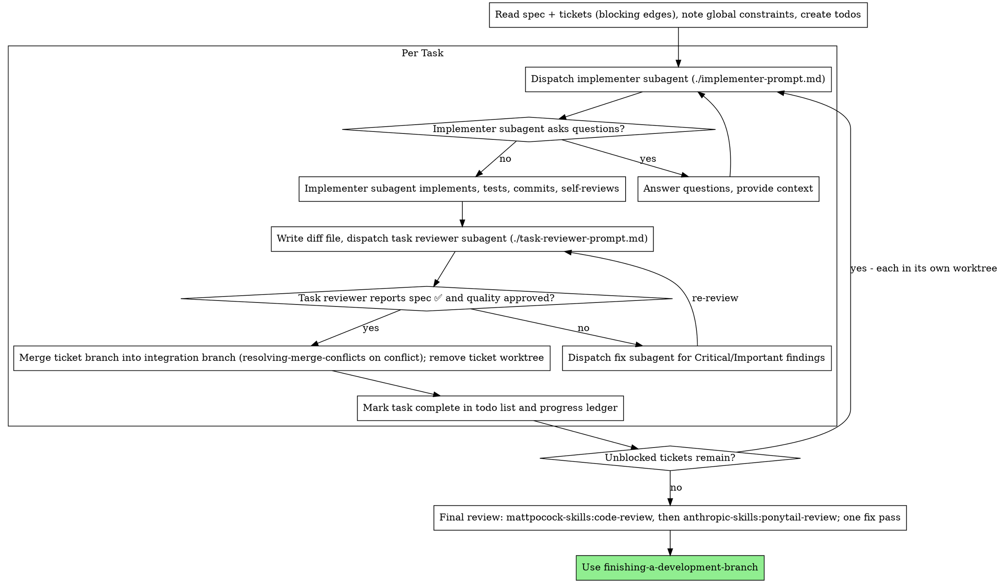

# Subagent-Driven Development

> Personal copy, vendored from superpowers 6.1.0 on 2026-10-14 and adapted to the
> engineering workflow in `core/WORKFLOW.md` (mattpocock-skills + ponytail). Plans come from
> `/to-spec` → `/to-tickets`; each ticket is a task and its own brief.

Execute the tickets by dispatching a fresh implementer subagent per ticket, a task review (spec compliance + code quality) after each, and a broad whole-branch review at the end.

**Why subagents:** You delegate tasks to specialized agents with isolated context. By precisely crafting their instructions and context, you ensure they stay focused and succeed at their task. They should never inherit your session's context or history — you construct exactly what they need. This also preserves your own context for coordination work.

**Core principle:** Fresh subagent per task + task review (spec + quality) + broad final review = high quality, fast iteration

**Narration:** between tool calls, narrate at most one short line — the
ledger and the tool results carry the record.

**Continuous execution:** Do not pause to check in with your human partner between tasks. Execute all tasks from the plan without stopping. The only reasons to stop are: BLOCKED status you cannot resolve, ambiguity that genuinely prevents progress, or all tasks complete. "Should I continue?" prompts and progress summaries waste their time — they asked you to execute the plan, so execute it.

## When to Use

- You have build tickets from `/to-tickets` (each with blocking edges) → use this skill.
- No tickets yet → `/grill-with-docs` (or `/wayfinder` for multi-session work) → `/to-spec` → `/to-tickets` first.
- One small ticket → `/implement` is enough.

What this gives you: fresh subagent per ticket (no context pollution), a review after each ticket (spec compliance + code quality), a broad review at the end, and no human-in-loop between tickets.

## The Process



## Pre-Flight Plan Review

Before dispatching the first ticket, scan the spec and tickets once for conflicts:

- tickets that contradict each other or the spec's Implementation Decisions,
  Testing Decisions or Out of Scope sections
- anything the plan explicitly mandates that the review rubric treats as a
  defect (a test that asserts nothing, verbatim duplication of a logic block)

Present everything you find to your human partner as one batched question —
each finding beside the plan text that mandates it, asking which governs —
before execution begins, not one interrupt per discovery mid-plan. If the
scan is clean, proceed without comment. The review loop remains the net for
conflicts that only emerge from implementation.

## Model Selection

**House rule (overrides the implementer guidance below):** implementer and fix
subagents run on `sonnet` for mechanical tickets (1-2 files, complete spec,
no design judgment) and on `opus` for every other ticket (multi-file,
integration, judgment). A fix round reuses the ticket's model. They load `ew-ponytail` first, then
`ew-matt-tdd`: simplest code that passes the test, stdlib/native
before deps, no speculative abstractions. The guidance below still applies to
reviewers.

## Token budget (house rule, measured 2026-10-16)

Cost here is calls x context: every call re-reads the whole conversation. In
the Open Thoughts build, 276 subagents (about 25 calls each, starting at 78K
tokens of inherited context) made 74% of all cache reads, and one orchestrator
session climbed to 966K tokens without compacting. So:

- **Agent budget per ticket:** one implementer, one task reviewer, at most one
  fix + re-review round. A second failed review means escalate to the
  controller, not a third loop.
- **Reviewers run on `sonnet`** (the per-ticket task review). Only the final
  whole-branch review runs on `opus`, once. No verifier fan-out: findings are
  checked by the single fix pass, not by one agent per finding.
- **Final review:** `code-review` and `ponytail-review` once each; no
  loop-until-dry, no multi-vote panels.
- **Lean subagents:** brief = its own ticket + context pack, nothing else. Tell
  it to stop and report BLOCKED after about 40 turns. Prefer a narrow
  `agentType`/tool set over `general-purpose` with all tools.
- **Controller hygiene:** the ledger is on disk, so compact or hand off the
  orchestrator session at about 300K tokens; never let it run to 900K.
- **Ultracode does not raise this budget.** Standing Workflow opt-in means use
  `pipeline()` over the ready tickets with the limits above, not extra
  verifiers. Set `effort: 'low'` on mechanical stages.

Use the least powerful model that can handle each role to conserve cost and increase speed.

**Mechanical implementation tasks** (isolated functions, clear specs, 1-2 files): use a fast, cheap model. Most implementation tasks are mechanical when the plan is well-specified.

**Integration and judgment tasks** (multi-file coordination, pattern matching, debugging): use a standard model.

**Architecture and design tasks**: use the most capable available model.
The final whole-branch review is one of these — dispatch it on the most
capable available model, not the session default.

**Review tasks**: choose the model with the same judgment, scaled to the
diff's size, complexity, and risk. A small mechanical diff does not need the
most capable model; a subtle concurrency change does.

**Always specify the model explicitly when dispatching a subagent.** An
omitted model inherits your session's model — often the most capable and
most expensive — which silently defeats this section.

**Turn count beats token price.** Wall-clock and context cost scale with how
many turns a subagent takes, and the cheapest models routinely take 2-3× the
turns on multi-step work — costing more overall. Use a mid-tier model as the
floor for reviewers and for implementers working from prose descriptions.
When the task's plan text contains the complete code to write, the
implementation is transcription plus testing: use the cheapest tier for
that implementer. Single-file mechanical fixes also take the cheapest tier.

**Task complexity signals (implementation tasks):**
- Touches 1-2 files with a complete spec → cheap model
- Touches multiple files with integration concerns → standard model
- Requires design judgment or broad codebase understanding → most capable model

## Handling Implementer Status

Implementer subagents report one of four statuses. Handle each appropriately:

**DONE:** From the integration checkout, generate the review package (`<SDD_SKILL_DIR>/scripts/review-package BASE <ticket-branch>` — it prints the unique file path it wrote; BASE is the integration tip you recorded when you created the ticket's worktree — never `HEAD~1`, which silently drops all but the last commit of a multi-commit task; and never literal `HEAD`, which in the integration checkout is the integration tip and yields an empty package), then dispatch the task reviewer with the printed path.

**DONE_WITH_CONCERNS:** The implementer completed the work but flagged doubts. Read the concerns before proceeding. If the concerns are about correctness or scope, address them before review. If they're observations (e.g., "this file is getting large"), note them and proceed to review.

**NEEDS_CONTEXT:** The implementer needs information that wasn't provided. Provide the missing context and re-dispatch.

**BLOCKED:** The implementer cannot complete the task. Assess the blocker:
1. If it's a context problem, provide more context and re-dispatch with the same model
2. If the task requires more reasoning, re-dispatch with a more capable model
3. If the task is too large, break it into smaller pieces
4. If the plan itself is wrong, escalate to the human

**Never** ignore an escalation or force the same model to retry without changes. If the implementer said it's stuck, something needs to change.

## Handling Reviewer ⚠️ Items

The task reviewer may report "⚠️ Cannot verify from diff" items — requirements
that live in unchanged code or span tasks. These do not block the rest of the
review, but you must resolve each one yourself before marking the task
complete: you hold the plan and cross-task context the reviewer
lacks. If you confirm an item is a real gap, treat it as a failed spec
review — send it back to the implementer and re-review.

## Constructing Reviewer Prompts

Per-task reviews are task-scoped gates. The broad review happens once, at the
final whole-branch review. When you fill a reviewer template:

- Do not add open-ended directives like "check all uses" or "run race tests
  if useful" without a concrete, task-specific reason
- Do not ask a reviewer to re-run tests the implementer already ran on the
  same code — the implementer's report carries the test evidence
- Do not pre-judge findings for the reviewer — never instruct a reviewer to
  ignore or not flag a specific issue. If you believe a finding would be a
  false positive, let the reviewer raise it and adjudicate it in the review
  loop. If the prompt you are writing contains "do not flag," "don't treat X
  as a defect," "at most Minor," or "the plan chose" — stop: you are
  pre-judging, usually to spare yourself a review loop.
- The global-constraints block you hand the reviewer is its attention
  lens. Copy the binding requirements verbatim from the plan's Global
  Constraints section or the spec: exact values, exact formats, and the
  stated relationships between components ("same layout as X", "matches
  Y"). The reviewer's template already carries the process rules (YAGNI,
  test hygiene, review method) — the constraints block is for what THIS
  project's spec demands.
- Hand the reviewer its diff as a file: run this skill's
  `<SDD_SKILL_DIR>/scripts/review-package BASE <ticket-branch>` from the integration checkout and pass the reviewer the file path
  it prints (or, without bash: `git log --oneline`, `git diff --stat`,
  and `git diff -U10` for the range, redirected to one uniquely named
  file). The output never enters your own context, and the reviewer sees
  the commit list, stat summary, and full diff with context in one Read
  call. Use the BASE you recorded before dispatching the implementer —
  never `HEAD~1`, which silently truncates multi-commit tasks.
- A dispatch prompt describes one task, not the session's history. Do not
  paste accumulated prior-task summaries ("state after Tasks 1-3") into
  later dispatches — a real session's dispatch hit 42k chars of which 99%
  was pasted history. A fresh subagent needs its task, the interfaces it
  touches, and the global constraints. Nothing else.
- Dispatch fix subagents for Critical and Important findings. Record Minor
  findings in the progress ledger as you go, and point the final
  whole-branch review at that list so it can triage which must be fixed
  before merge. A roll-up nobody reads is a silent discard.
- A finding labeled plan-mandated — or any finding that conflicts with
  what the plan's text requires — is the human's decision, like any plan
  contradiction: present the finding and the plan text, ask which governs.
  Do not dismiss the finding because the plan mandates it, and do not
  dispatch a fix that contradicts the plan without asking.
- The final whole-branch review gets a package too: run
  `<SDD_SKILL_DIR>/scripts/review-package MERGE_BASE HEAD` (MERGE_BASE = the commit the
  branch started from, e.g. `git merge-base main HEAD`) and include the
  printed path in the final review dispatch, so the final reviewer reads
  one file instead of re-deriving the branch diff with git commands.
- Every fix dispatch carries the implementer contract: the fix subagent
  re-runs the tests covering its change and reports the results. Name the
  covering test files in the dispatch — a one-line fix does not need the
  whole suite. Before re-dispatching the reviewer, confirm the fix report
  contains the covering tests, the command run, and the output; dispatch
  the re-review once all three are present.
- If the final whole-branch review returns findings, dispatch ONE fix
  subagent with the complete findings list — not one fixer per finding.
  Per-finding fixers each rebuild context and re-run suites; a real
  session's final-review fix wave cost more than all its tasks combined.

## File Handoffs

Everything you paste into a dispatch prompt — and everything a subagent
prints back — stays resident in your context for the rest of the session
and is re-read on every later turn. Hand artifacts over as files:

- **Task brief = the ticket.** `/to-tickets` already writes one ticket per
  task, so there is no plan to slice. Before dispatching an implementer,
  copy the ticket into the SDD workspace
  under a per-feature folder (`W=$(<SDD_SKILL_DIR>/scripts/sdd-workspace)/<feature>`;
  `mkdir -p "$W"`; `<feature>` = the `.scratch/<feature>/` slug for local
  tickets, or the parent issue number on GitHub):
  local tracker → `cp <ticket-file> "$W/task-<id>-brief.md"`;
  GitHub → `gh issue view <n> --comments > "$W/task-<n>-brief.md"`.
  If the ticket leans on the spec, append the spec sections it cites to the
  brief rather than handing over the whole spec. Compose the dispatch so the
  brief stays the single source of requirements. Your dispatch should
  contain: (1) one line on where this task fits in the project; (2) the
  brief path, introduced as "read this first — it is your requirements,
  with the exact values to use verbatim"; (3) interfaces and decisions
  from earlier tasks that the brief cannot know (put these in the
  context pack, below); (4) your resolution of
  any ambiguity you noticed in the brief; (5) the report-file path and
  report contract. Exact values (numbers, magic strings, signatures, test
  cases) appear only in the brief.
- **Context pack.** Append a `## Context pack` section to the brief so the
  implementer reads it instead of exploring the repo. Build it from the
  integration-branch tip, never from memory, so it cannot drift:
  (a) verbatim signatures of the interfaces the ticket touches, plus their
  callers (`/graphify query` or grep, then copy the lines); (b) integration
  points: what calls the new code and what it must call; (c) the
  `GLOSSARY.md` terms and ADRs that bear on the ticket, quoted; (d) gotchas
  you know (missing env or keys and the fakes to use, files not to touch);
  (e) the runnable commands that prove the ticket is done. Aim for under
  ~150 lines. The pack lives only in the SDD workspace and is never
  committed. When a report says the pack fell short, fix that gap in the
  next pack.
- **Report file:** name the implementer's report file after the brief
  (brief `…/task-N-brief.md` → report `…/task-N-report.md`) and put it in
  the dispatch prompt. The implementer writes the full report there and
  returns only status, commits, a one-line test summary, and concerns.
- **Reviewer inputs:** the task reviewer gets three paths — the same brief
  file, the report file, and the review package — plus the global
  constraints that bind the task.
- Fix dispatches append their fix report (with test results) to the same
  report file and return a short summary; re-reviews read the updated file.

## Parallel Tickets

Build on one integration branch (e.g. `build/<feature>`), cut from the
default branch and checked out in the controller's checkout. For each
ticket whose blockers are all merged:

1. **Cut its worktree yourself** from the integration tip (once per repo: `echo .worktrees/ >> .git/info/exclude`):
   `BASE=$(git rev-parse <integration-branch>)`;
   `git worktree add -b ticket/<feature>-<id> .worktrees/<feature>-<id> "$BASE"`.
   Do not use Agent `isolation: "worktree"` — it branches from
   origin/<default-branch> (or fails with no remote), so the ticket would not
   see its merged blockers.
2. **Dispatch the implementer** (no isolation) with "Work from:
   `<absolute worktree path>` — cd there first; use absolute paths under it;
   commit on branch `ticket/<feature>-<id>`". Record BASE, branch and path in
   the ledger.
3. **Review** from the integration checkout:
   `review-package BASE ticket/<feature>-<id>`.
4. **Fixes go to the same worktree:** dispatch fix subagents (no isolation)
   with the same "Work from:" path, or resume the implementer with
   SendMessage. Re-review with a fresh `review-package BASE <ticket-branch>`.
5. **Merge** the approved branch into the integration branch
   (native merge-conflict handling on conflict), then
   `git worktree remove .worktrees/<feature>-<id>` and
   `git branch -d ticket/<feature>-<id>`, then log it complete and dispatch
   whatever it unblocked.

Sequential builds can skip the worktrees and commit on the integration
branch directly; BASE is then the tip before dispatch and HEAD is fine.

## Durable Progress

Conversation memory does not survive compaction. In real sessions,
controllers that lost their place have re-dispatched entire completed task
sequences — the single most expensive failure observed. Track progress in
a ledger file, not only in todos.

- At skill start, check for a ledger:
  `cat "$(<SDD_SKILL_DIR>/scripts/sdd-workspace)/<feature>/progress.md"`
  (one ledger per feature, so ticket ids restarting at 01 in the next
  feature are never mistaken for done). Tasks listed there
  as complete are DONE — do not re-dispatch them; resume at the first task
  not marked complete.
- When a task's review comes back clean and it is merged, append one line to the ledger in
  the same message as your other bookkeeping:
  `Task N: complete (commits <base7>..<head7>, review clean)`.
- The ledger is your recovery map: the commits it names exist in git even
  when your context no longer remembers creating them. After compaction,
  trust the ledger and `git log` over your own recollection.
- `git clean -fdx` will destroy the ledger (it's git-ignored scratch); if
  that happens, recover from `git log`.
- With parallel tickets in separate worktrees, keep the ledger, briefs and
  review packages in the **integration-branch checkout** (run
  `<SDD_SKILL_DIR>/scripts/sdd-workspace` from there), not inside each ticket's worktree, which is
  removed after merge. Log a ticket complete only after its review is clean
  **and** it is merged into the integration branch.

## Prompt Templates

- [implementer-prompt.md](implementer-prompt.md) - Dispatch implementer subagent
- [task-reviewer-prompt.md](task-reviewer-prompt.md) - Dispatch task reviewer subagent (spec compliance + code quality)
- Final whole-branch review: `ew-matt-code-review` (standards + spec) on the whole branch, then `ew-ponytail-review` for bloat; hand both the `MERGE_BASE..HEAD` review package, then ONE fix subagent for both findings lists

## Example Workflow

```
You: I'm using Subagent-Driven Development to build these tickets.

[Read the spec and the ticket list once (titles + blocking edges)]
[Create todos for all tickets]

Ticket 1: Hook installation script

[Copy ticket 1 into the SDD workspace as its brief; dispatch implementer with brief + report paths + context]

Implementer: "Before I begin - should the hook be installed at user or system level?"

You: "User level (~/.config/superpowers/hooks/)"

Implementer: "Got it. Implementing now..."
[Later] Implementer:
  - Implemented install-hook command
  - Added tests, 5/5 passing
  - Self-review: Found I missed --force flag, added it
  - Committed

[Run review-package, dispatch task reviewer with the printed path]
Task reviewer: Spec ✅ - all requirements met, nothing extra.
  Strengths: Good test coverage, clean. Issues: None. Task quality: Approved.

[Mark Task 1 complete]

Task 2: Recovery modes

[Copy ticket 2 into the SDD workspace as its brief; dispatch implementer with brief + report paths + context]

Implementer: [No questions, proceeds]
Implementer:
  - Added verify/repair modes
  - 8/8 tests passing
  - Self-review: All good
  - Committed

[Run review-package, dispatch task reviewer with the printed path]
Task reviewer: Spec ❌:
  - Missing: Progress reporting (spec says "report every 100 items")
  - Extra: Added --json flag (not requested)
  Issues (Important): Magic number (100)

[Dispatch fix subagent with all findings]
Fixer: Removed --json flag, added progress reporting, extracted PROGRESS_INTERVAL constant

[Task reviewer reviews again]
Task reviewer: Spec ✅. Task quality: Approved.

[Mark Task 2 complete]

...

[After all tickets]
[Final review: mattpocock-skills:code-review, then anthropic-skills:ponytail-review]
Final reviewers: All requirements met, nothing to delete, ready to merge

Done!
```

## Advantages

**vs. Manual execution:**
- Subagents follow TDD naturally
- Fresh context per task (no confusion)
- Parallel-safe (subagents don't interfere)
- Subagent can ask questions (before AND during work)

**Efficiency gains:**
- Controller curates exactly what context is needed; bulk artifacts move
  as files, not pasted text
- Subagent gets complete information upfront
- Questions surfaced before work begins (not after)

**Quality gates:**
- Self-review catches issues before handoff
- Task review carries two verdicts: spec compliance and code quality
- Review loops ensure fixes actually work
- Spec compliance prevents over/under-building
- Code quality ensures implementation is well-built

**Cost:**
- More subagent invocations (implementer + reviewer per task)
- Controller does more prep work (extracting all tasks upfront)
- Review loops add iterations
- But catches issues early (cheaper than debugging later)

## Red Flags

**Never:**
- Start implementation on main/master branch without explicit user consent
- Skip task review, or accept a report missing either verdict (spec compliance AND task quality are both required)
- Proceed with unfixed issues
- Dispatch parallel implementers into the same working tree, or with Agent
  `isolation: "worktree"` (it branches from origin/<default-branch>, not the
  integration tip — see "Parallel Tickets"). A ticket is dispatched only
  after every ticket blocking it is merged
- Make a subagent read the whole spec or every ticket (hand it its own
  ticket as the brief instead)
- Skip scene-setting context (subagent needs to understand where task fits)
- Ignore subagent questions (answer before letting them proceed)
- Accept "close enough" on spec compliance (reviewer found spec issues = not done)
- Skip review loops (reviewer found issues = implementer fixes = review again)
- Let implementer self-review replace actual review (both are needed)
- Tell a reviewer what not to flag, or pre-rate a finding's severity in the
  dispatch prompt ("treat it as Minor at most") — the plan's example code is
  a starting point, not evidence that its weaknesses were chosen
- Dispatch a task reviewer without a diff file — generate it first
  (`<SDD_SKILL_DIR>/scripts/review-package BASE <ticket-branch>`) and name the printed path in the
  prompt
- Move to next task while the review has open Critical/Important issues
- Re-dispatch a task the progress ledger already marks complete — check
  the ledger (and `git log`) after any compaction or resume

**If subagent asks questions:**
- Answer clearly and completely
- Provide additional context if needed
- Don't rush them into implementation

**If reviewer finds issues:**
- Implementer (same subagent) fixes them
- Reviewer reviews again
- Repeat until approved
- Don't skip the re-review

**If subagent fails task:**
- Dispatch fix subagent with specific instructions
- Don't try to fix manually (context pollution)

## Integration

**Upstream:** `/to-spec` → `/to-tickets` (mattpocock-skills) create the tickets this skill builds.

**Isolation:** one `git worktree add` per ticket, cut from the integration branch by the controller (see "Parallel Tickets"); not Agent `isolation: "worktree"`; native merge-conflict handling when merging a ticket back.

**Subagents use:** `ew-ponytail`, then `ew-matt-tdd`.

**Reviews:** `receiving-code-review` when handling reviewer findings; final review `ew-matt-code-review` + `ew-ponytail-review`; `/security-review` for auth, input handling, secrets or payments.

**After:** `verification-before-completion` before claiming done → `finishing-a-development-branch` → `graphify update .` (no LLM; `/graphify . --update` when docs changed).
